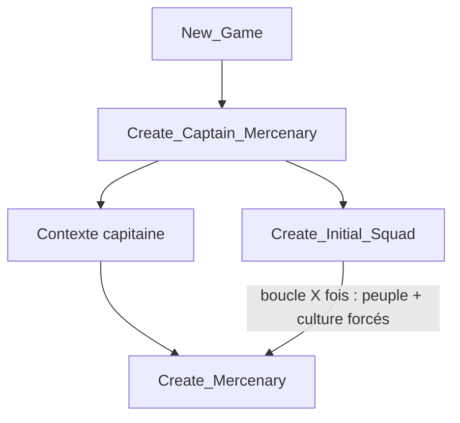

> Source de vérité Git. Migré depuis l'export Notion figé du 2026-10-03.

# 00 — Démarrage de partie & fonctions de génération

Cette page décrit l’ordre d’appel des fonctions de création au démarrage d’une partie et les biais introduits par le capitaine dans la génération ultérieure des mercenaires.

<aside>
🎛️

Les valeurs réglables du biais capitaine sont centralisées dans [Constantes de formule](05%20%E2%80%94%20R%C3%A9f%C3%A9rentiels%20techniques/Constantes%20de%20formule%202a25d0db802141bb8e0273935c2be8c2.md), vue **Génération — capitaine** : `generation.captain.people_bonus_pp = 9`, `generation.captain.other_people_malus_pp = -1`, `generation.captain.ascendance_weight_multiplier = 2`, `generation.captain.culture_weight_multiplier = 2`.

</aside>



## `New_Game`

Responsabilité connue à ce stade : déclencher la création du capitaine, puis lancer la création de l’escouade initiale.

```jsx
function New_Game(playerChoices) {
    const captain = Create_Captain_Mercenary(playerChoices);
    const initialSquad = Create_Initial_Squad(captain);

    return { captain, initialSquad };
}
```

## `Create_Captain_Mercenary`

Le capitaine est un mercenaire particulier dont **l’identité est orientée par les choix du joueur**.

Le joueur choisit :

- le peuple ;
- s’il souhaite une ascendance ;
- la culture ;
- l’origine sociale ;
- l’alignement.

Les jets de caractéristiques ne sont **pas améliorés, relancés ou modifiés par ces choix**. On utilise les mêmes jets bruts que pour un mercenaire normal : caractéristiques fondamentales = `20 + 3D20`, résistances = `1D6`. Les choix déterminent simplement quels modificateurs de peuple, ascendance, culture et origine seront ensuite appliqués.

Si le joueur demande une ascendance :

- il **choisit directement le type d’ascendance** parmi les ascendances compatibles avec son peuple ;
- le capitaine reçoit directement une **ascendance de niveau 3** ;
- les modificateurs correspondants sont lus dans la Matrice de génération et convertis avec l’échelle D6 du niveau 3.

```jsx
function Create_Captain_Mercenary(playerChoices) {
    const mercenary = Roll_Base_Mercenary_Stats();

    mercenary.peuple = playerChoices.peuple;
    mercenary.culture = playerChoices.culture;
    mercenary.origin = playerChoices.origin;
    mercenary.alignment = playerChoices.alignment;
    mercenary.company_leader = true;

    if (playerChoices.wantsAscendance) {
        Assert_Ascendance_Compatible(
            playerChoices.ascendance,
            mercenary.peuple
        );

        mercenary.hasAscendance = true;
        mercenary.ascendance = playerChoices.ascendance;
        mercenary.ascendanceLevel = 3;
    } else {
        mercenary.hasAscendance = false;
        mercenary.ascendance = null;
        mercenary.ascendanceLevel = null;
    }

    Apply_Generation_Modifiers(mercenary);
    Compute_Initial_Derived_Values(mercenary);

    return mercenary;
}
```

<aside>
🎲

Les choix du joueur n’altèrent jamais les jets bruts. Ils orientent uniquement **quels** modificateurs et tables sont utilisés ensuite.

</aside>

## `Create_Initial_Squad`

Fonction appelée après la création du capitaine. Elle crée une **boucle de X mercenaires** dont le **peuple** et la **culture** sont forcés à ceux du capitaine.

La taille `X` dépend du peuple du capitaine et du fait qu’il possède ou non une ascendance :

| Peuple du capitaine | Sans ascendance | Avec ascendance |
| --- | --- | --- |
| Ogre | `1D3 + 1` | `1D3` |
| Elfe / Reptilien / Homme-bête | `2D6 + 3` | `2D6` |
| Nain / Orc / Humain | `3D6 + 4` | `3D6` |
| Gnome / Gobelin / Halfling | `4D6 + 6` | `4D6` |

Seuls **Peuple** et **Culture** sont forcés par `Create_Initial_Squad`. Le reste de la génération passe par `Create_Mercenary` normalement : jets bruts, ascendance éventuelle, niveau d’ascendance, origine sociale, modificateurs et valeurs dérivées.

```jsx
function Roll_Initial_Squad_Size(captain) {
    const hasAscendance = captain.hasAscendance === true;

    switch (captain.peuple) {
        case "Ogre":
            return Roll_D3() + (hasAscendance ? 0 : 1);

        case "Elfe":
        case "Reptilien":
        case "Homme-bête":
            return Roll_Dice(2, 6) + (hasAscendance ? 0 : 3);

        case "Nain":
        case "Orc":
        case "Humain":
            return Roll_Dice(3, 6) + (hasAscendance ? 0 : 4);

        case "Gnome":
        case "Gobelin":
        case "Halfling":
            return Roll_Dice(4, 6) + (hasAscendance ? 0 : 6);
    }
}

function Create_Initial_Squad(captain) {
    const squad = [];
    const count = Roll_Initial_Squad_Size(captain);

    for (let i = 0; i < count; i++) {
        squad.push(
            Create_Mercenary(captain, {
                forcedPeuple: captain.peuple,
                forcedCulture: captain.culture
            })
        );
    }

    return squad;
}
```

## `Create_Mercenary`

`Create_Mercenary` utilise le pipeline normal de génération, mais reçoit le capitaine comme **contexte de pondération**.

### 1. Biais de peuple

Avant le tirage du peuple :

- peuple identique à celui du capitaine : **+9 points de pourcentage** ;
- chacun des 9 autres peuples : **−1 point de pourcentage**.

Avec les 10 peuples actuels, le total reste donc à 100 %.

```jsx
function Get_Mercenary_People_Probabilities(captain, baseProbabilities) {
    const probabilities = { ...baseProbabilities };

    for (const peuple of Object.keys(probabilities)) {
        probabilities[peuple] += (peuple === captain.peuple)
            ? CAPTAIN_PEOPLE_BONUS_PP
            : CAPTAIN_OTHER_PEOPLE_MALUS_PP;
    }

    return probabilities;
}
```

### 2. Biais d’ascendance

La probabilité **d’avoir ou non** une ascendance ne change pas.

Si :

- `mercenary.peuple === captain.peuple` ;
- `mercenary.hasAscendance === true` ;
- le capitaine possède lui-même une ascendance ;
- cette ascendance est compatible avec le peuple du mercenaire ;

alors le **poids relatif du type d’ascendance du capitaine est multiplié par 2** avant le tirage. Les autres poids restent inchangés. Le tirage est ensuite normalisé comme tout tirage pondéré.

```jsx
function Get_Ascendance_Weights(mercenary, captain, baseWeights) {
    const weights = { ...baseWeights };

    if (
        mercenary.peuple === captain.peuple &&
        mercenary.hasAscendance === true &&
        captain.hasAscendance === true &&
        weights[captain.ascendance] !== undefined
    ) {
        weights[captain.ascendance] *= CAPTAIN_ASCENDANCE_WEIGHT_MULTIPLIER;
    }

    return weights;
}
```

### 3. Biais de culture

Au moment de tirer la culture, si la culture du capitaine est compatible avec le peuple du mercenaire, son **poids relatif est multiplié par 2**. Les autres cultures conservent leur poids normal.

```jsx
function Get_Culture_Weights(mercenary, captain, baseWeights) {
    const weights = { ...baseWeights };

    if (weights[captain.culture] !== undefined) {
        weights[captain.culture] *= CAPTAIN_CULTURE_WEIGHT_MULTIPLIER;
    }

    return weights;
}
```

### Pipeline résumé

```jsx
function Create_Mercenary(captain, overrides = {}) {
    const mercenary = Roll_Base_Mercenary_Stats();

    mercenary.peuple = overrides.forcedPeuple ?? Weighted_Draw(
        Get_Mercenary_People_Probabilities(captain, PEOPLE_BASE_PROBABILITIES)
    );
    Apply_People_Stat_Modifiers(mercenary);
    Collect_People_Skill_Modifiers(mercenary);

    mercenary.hasAscendance = Roll_Ascendance_Presence(mercenary.peuple);

    if (mercenary.hasAscendance) {
        const baseAscendanceWeights = Get_Compatible_Ascendance_Weights(mercenary.peuple);
        const ascendanceWeights = Get_Ascendance_Weights(
            mercenary,
            captain,
            baseAscendanceWeights
        );

        mercenary.ascendance = Weighted_Draw(ascendanceWeights);
        mercenary.ascendanceLevel = Roll_Ascendance_Level();
        Apply_Ascendance_Stat_Modifiers(mercenary);
        Collect_Ascendance_Skill_Modifiers(mercenary);
    }

    if (overrides.forcedCulture !== undefined) {
        Assert_Culture_Compatible(overrides.forcedCulture, mercenary.peuple);
        mercenary.culture = overrides.forcedCulture;
    } else {
        const baseCultureWeights = Get_Compatible_Culture_Weights(mercenary.peuple);
        const cultureWeights = Get_Culture_Weights(mercenary, captain, baseCultureWeights);
        mercenary.culture = Weighted_Draw(cultureWeights);
    }
    Apply_Culture_Stat_Modifiers(mercenary);
    Collect_Culture_Skill_Modifiers(mercenary);

    mercenary.origin = Weighted_Draw(
        Get_Compatible_Origin_Weights(mercenary.culture)
    );
    Apply_Origin_Stat_Modifiers(mercenary);
    Collect_Origin_Skill_Modifiers(mercenary);

    Roll_Base_Mercenary_Skills(mercenary, captain);
    Apply_Collected_Skill_Modifiers(mercenary);

    Compute_Initial_Derived_Values(mercenary);
    return mercenary;
}
```

<aside>
🧭

Le capitaine modifie les probabilités de peuple, de type d’ascendance et de culture. **Décision de conception : les jets de dés effectués dans `Create_Mercenary` doivent également être pondérés par la réputation du capitaine / de sa compagnie.** Les formules actuelles (`20 + 3D20`, `1D20`, `2D20`, etc.) sont donc des distributions de base et ne doivent pas être codées comme des constantes rigides. Plus la compagnie devient réputée, plus le niveau des candidats susceptibles de se présenter doit pouvoir monter. Dans `Create_Initial_Squad`, le peuple et la culture restent exceptionnellement forcés à ceux du capitaine.

</aside>

## Ouverture narrative — version retenue

La partie s’ouvre par une cinématique en **vue subjective** dans un château en ruines au milieu d’une bataille chaotique où Orcs, Elfes et Humains s’affrontent.

Le personnage-joueur fuit, se réfugie dans une petite pièce et reprend son souffle. Un homme en armure, grièvement blessé à l’abdomen, entre et s’effondre près de lui : barbe blanche parfaitement taillée, cheveux courts, allure de vieux « Prince Charmant ».

Il annonce que la bataille est perdue, que Garreth, Ludwig et les autres sont morts, dit avoir toujours cru au potentiel du personnage-joueur et lui demande de les venger.

Il lui remet ensuite sa chevalière et le nomme **capitaine** :

> « Bob, tu es le capitaine à présent. Tu es le dernier vivant, mais je suis certain que tu seras un bon capitaine. Tu t’appelles bien Bob ? »
> 

Fin de cinématique :

> **« Vous vous appelez Bob ? Tapez votre nom : »**
> 

Le joueur configure ensuite son capitaine.

<aside>
🏰

Le château en ruines de cette introduction devient la **base / camp** de la compagnie et sera restauré puis agrandi pendant la partie.

</aside>

La cinématique présente le capitaine comme dernier survivant immédiat de la scène, mais le système de jeu conserve ensuite la génération de l’**Initial Squad** existante. La justification narrative précise de ce groupe pourra être affinée plus tard sans modifier la fonction.

## Hiérarchie de compagnie

Hiérarchie retenue : **Capitaine → Lieutenants → Mercenaires**.

- un seul Capitaine ;
- plusieurs Lieutenants possibles ;
- Lieutenant est un **rang / statut porté par un mercenaire**, pas un type de personnage séparé ;
- les effets précis du grade de Lieutenant restent à définir.

<aside>
☠️

**Le capitaine n’a pas de succession : sa mort entraîne Game Over.**

</aside>