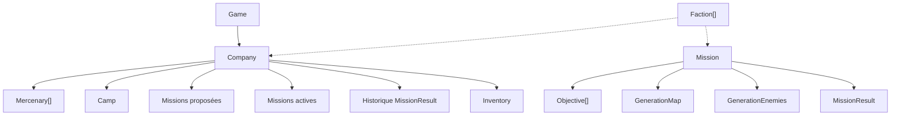

> Source de vérité Git. Migré depuis l'export Notion figé du 2026-10-03.

# 06 — Architecture & objets de jeu

<aside>
🧱

**Architecture conceptuelle — version de travail.** Cette page décrit les grands objets persistants du jeu et leurs relations. Les règles détaillées restent dans leurs pages dédiées.

</aside>

## Principe général

La sauvegarde conserve les **sources de vérité persistantes** et évite de stocker inutilement ce qui peut être recalculé.

- Une caractéristique conserve sa **valeur** et son **XP**.
- Les PV max, l’initiative, les chances de toucher et autres valeurs calculées sont **dérivées**.
- Les objets procéduraux importants sont **générés une fois puis stockés** : un mercenaire recruté ne doit pas être régénéré à chaque chargement ; une mission proposée doit rester identique tant qu’elle existe.

### Sauvegarde du prototype

Implémentation actuelle (prototype web) : l'état de partie de `game-core/campaign.js` (jour, compagnie, Taverne) est sérialisé en JSON avec un format (`mercenaires-save`) et une version (`1`) par `serializeCampaign`, puis relu et vérifié par `restoreCampaign`. Le prototype le sauvegarde automatiquement dans le navigateur après chaque action de la compagnie ou de la Taverne, et propose « Continuer » au démarrage. Un combat en cours et le banc de test du générateur ne sont pas sauvegardés. La **trace de génération** des mercenaires (le détail de calcul affiché dans la fiche, environ 85 % de leur poids) n'est pas sauvegardée non plus : un mercenaire pèse environ 5 Ko dans la sauvegarde au lieu de 36 Ko, et sa fiche n'affiche plus que les valeurs finales après un chargement. Le stockage du navigateur (environ 5 Mo) laisse ainsi de la place pour environ 1 000 mercenaires. La mort du capitaine met fin à la partie et **efface la sauvegarde** (décision Idan, 2026-10-03).

## Vue d’ensemble

## 1 — Game

Objet racine de sauvegarde.

**Contenu connu :**

- identifiant de partie ;
- date courante ;
- compagnie du joueur ;
- monde courant.

Le monde reste volontairement ouvert pour accueillir plus tard factions, événements, lieux et autres systèmes globaux.

## 2 — Company

La **compagnie** est le conteneur principal de la couche gestion.

**Données principales :**

- identifiant ;
- nom ;
- or ;
- **renommée de compagnie** ;
- alignement de compagnie, porté par le capitaine ;
- capitaine ;
- liste des mercenaires ;
- camp ;
- inventaire commun ;
- missions proposées ;
- missions actives ;
- historique des missions terminées.

**Responsabilités :**

- posséder le roster ;
- porter les ressources de la compagnie ;
- stocker la **renommée de compagnie** ;
- centraliser les missions disponibles et engagées ;
- conserver l’historique de campagne.

La renommée de compagnie est distincte de la réputation personnelle d’un mercenaire et de l’alignement moral. Architecture actuelle : `PointsMissions + ReputationDeveloppementCamp + PrestigeTop10Mercenaires`. Voir [Réputation, renommée & salaires](/design/#doc=09-reputation-renown-and-salaries.md). Les réputations par faction seront précisées avec l’objet **Faction**.

## 3 — Mercenary

Le mercenaire est un objet **généré procéduralement puis persistant pendant toute sa carrière**.

La fonction de génération existe déjà dans [00 — Démarrage de partie & fonctions de génération](/design/#doc=01-start-and-generation-functions.md). Jusqu’ici, sa structure était répartie entre identité, caractéristiques, compétences et combat ; cette section formalise l’objet global.

### Identité

- identifiant ;
- nom ;
- âge ;
- peuple ;
- ascendance et niveau d’ascendance ;
- culture ;
- origine sociale ;
- alignement ;
- titres acquis ;
- rang : Mercenaire / Lieutenant / Capitaine.

Hiérarchie : **1 Capitaine**, plusieurs Lieutenants possibles, puis les Mercenaires. Lieutenant est un statut appliqué à un mercenaire existant. **Mort du Capitaine = Game Over** ; il n’existe pas de succession.

### Progression

- caractéristiques : valeur + XP ;
- résistances : valeur + XP ;
- compétences : valeur + XP.

La conversion universelle XP → niveau est définie dans [Progression & expérience](/design/#doc=08-progression-and-experience.md).

### État courant

- PV actuels ;
- mana actuel ;
- fatigue ;
- stress ;
- blessures persistantes ;
- statut général.

**Statuts à prévoir au minimum :**

- actif ;
- blessé ;
- mort ;
- capturé ;
- éventuellement disparu / indisponible.

### Combat

- équipement porté ;
- inventaire personnel éventuel ;
- sorts connus ;
- aptitudes.

### Carrière

- prétentions salariales cachées ;
- salaire contractuel ;
- réputation personnelle calculée ;
- disponibilité ;
- historique des missions ;
- statistiques persistantes utiles, par exemple nombre d’ennemis tués.

<aside>
📌

**Règle : ne pas dupliquer les valeurs dérivées.** Si une valeur peut être recalculée de manière fiable à partir des sources persistantes, elle n’a pas vocation à devenir une seconde source de vérité.

</aside>

## 4 — Mission

Une **Mission** est générée procéduralement puis stockée comme objet stable dès qu’elle est proposée à la compagnie.

Elle décrit **ce qui est proposé, attendu et générable**, pas ce qui s’est réellement produit.

### Identité

- identifiant ;
- nom ;
- description.

### Temps

- **Distance du camp en jours** : durée d’un trajet aller.

Règle V1 : **le combat lui-même compte pour 0 jour**.

`Temps voyage = Distance camp × 2`

Hors événement spécial, `Temps total mission = Distance camp × 2`. La couche gestion avance en jours. Voir [Fin de mission, temps & indisponibilités](/design/#doc=10-mission-time-and-unavailability.md).

### Objectifs

Chaque objectif doit être un petit objet exploitable par les règles, et non un simple texte.

**Objective :**

- type ;
- cible ;
- obligatoire : oui / non ;
- accompli : oui / non ;
- récompense en or éventuelle ;
- influence de réputation éventuelle.

Certains objectifs ou paramètres peuvent être cachés au joueur.

### Influence de réputation

La mission peut porter des conséquences potentielles sur :

- réputation générale ;
- réputation auprès du commanditaire ;
- réputation auprès de la faction cible ;
- autres réputations futures.

### Récompense contractuelle

- gain d’or prévu ;
- items de récompense prévus.

### Butin potentiel

À distinguer de la prime :

- table de butin ;
- argent trouvable ;
- items récupérables ;
- ressources éventuelles.

### Génération de carte

**GenerationMap** peut contenir notamment :

- biome ;
- taille ;
- densité de couvert ;
- relief ;
- bâtiments ;
- conditions spéciales.

Il s’agit de **paramètres de génération**, pas nécessairement de la carte finale stockée.

### Génération des ennemis

**GenerationEnemies** peut contenir notamment :

- faction ;
- budget de puissance ;
- nombre minimum ;
- nombre maximum ;
- types autorisés ;
- chance d’élite ;
- boss éventuel.

Principe retenu : générer le roster concret à partir d’un **budget de puissance et de contraintes**, plutôt que figer systématiquement une liste d’ennemis dans chaque modèle de mission.

### Relations futures

- faction commanditaire ;
- faction cible ;
- budget / difficulté de mission.

## 5 — MissionResult

Objet distinct de **Mission**.

**Mission décrit ce qui devait ou pouvait arriver. MissionResult décrit ce qui est réellement arrivé.**

Données envisagées :

- mission liée ;
- résultat : réussite / échec / abandon ;
- objectifs accomplis ;
- mercenaires participants ;
- morts ;
- blessés ;
- capturés ;
- variations d’XP ;
- variations de réputation ;
- or réellement gagné ;
- items réellement gagnés ;
- temps réellement écoulé.

MissionResult doit aussi pouvoir conserver les données nécessaires à la résolution post-combat :

- dégâts cumulés subis par participant ;
- PV de fin ;
- morts / survivants ;
- blessures et durée d’indisponibilité ;
- fatigue ;
- date / jour de retour prévu ;
- consommations ;
- pertes de matériel ;
- prisonniers ;
- événements de retour ;
- autres conséquences de fin de mission.

Voir [Fin de mission, temps & indisponibilités](/design/#doc=10-mission-time-and-unavailability.md).

## 6 — Camp

Le **camp** appartient à la compagnie mais mérite son propre objet, car il porte toute la couche construction / récupération / formation.

Données envisagées :

- bâtiments ;
- salles d’entraînement ;
- stockage ;
- prisonniers ;
- mercenaires blessés ;
- améliorations.

Responsabilités :

- construction et amélioration ;
- stockage ;
- soins et récupération ;
- gestion des blessés ;
- gestion des prisonniers ;
- entraînements hebdomadaires ;
- affectation professeurs / élèves ;
- futurs systèmes de production ou recherche.

Le système d’XP choisie au camp est décrit dans [Progression & expérience](/design/#doc=08-progression-and-experience.md).

**L’agenda d’un mercenaire** (Idan, 2026-11-04) : les activités qui le retiennent au camp — apprentissages (sort, port
d’armure, empoisonnement) et corvées (bûcheron, mineur) — sont inscrites une fois dans une seule liste
(`game-core/agenda.js`), dans l’ordre où leurs raisons s’affichent. Chaque activité demande à l’agenda ce qui le retient
ailleurs ; les missions, la garde du corps et l’entraînement libre lui demandent ce qui le retient tout court. Une corvée ne
regarde les autres corvées que pour demain (une seule corvée par jour ; bûcheron aujourd’hui, mineur demain, c’est
possible). Ajouter une activité, c’est une inscription de plus (`agenda.add` dans `campaign.js`), sans toucher aux autres.
Les postes, les missions et les blessures restent vérifiés à part. Test : `tests/agenda.test.js`.

## 7 — Inventory / Item

L’inventaire commun de la compagnie doit être distingué de l’équipement porté par les mercenaires.

À définir plus tard :

- structure d’un Item ;
- quantités et empilement ;
- consommables ;
- armes et armures uniques ;
- munitions ;
- objets de mission ;
- valeur marchande ;
- état / usure éventuelle.

## 8 — Faction — grand objet futur identifié

Faction n’est pas encore défini mais doit être prévu comme objet persistant du monde.

Il devra probablement porter :

- identité ;
- relations avec les autres factions ;
- réputation de la compagnie auprès d’elle ;
- types de missions générables ;
- tables d’ennemis ;
- territoires / biomes associés ;
- ressources et récompenses possibles.

Les missions pourront notamment référencer une **faction commanditaire** et une **faction cible**.

## 9 — Relations essentielles

| Objet | Rôle | Persistance |
| --- | --- | --- |
| Game | Racine de la sauvegarde | Oui |
| Company | Roster, camp, ressources, missions, renommée | Oui |
| Mercenary | Personnage généré puis évolutif | Oui |
| Mission | Contrat et paramètres procéduraux | Oui tant qu’elle existe |
| MissionResult | Archive factuelle d’une mission jouée | Oui |
| Camp | Construction, soins, entraînement, stockage | Oui |
| Faction | Objet du monde lié aux missions et réputations | Oui |

## 10 — Règle d’architecture

> **Générer → stocker les données persistantes → recalculer les valeurs dérivées.**
> 

Cette page reste volontairement une **vue d’ensemble**. Les formules précises et les mécaniques détaillées restent dans leurs sections spécialisées afin de conserver une seule source de vérité par règle.

[Camp & château en ruines](/design/#doc=11-camp-and-ruined-castle.md)