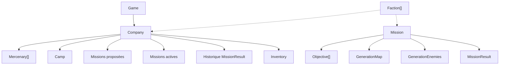

# Architecture & objets de jeu

Les grands objets persistants et leurs relations, pour le futur portage Unreal. Règle d'architecture (§10) : **générer
→ stocker les données persistantes → recalculer les valeurs dérivées**.

## Principe général

- La sauvegarde garde les **sources de vérité persistantes**, rien de ce qui se recalcule. Une caractéristique garde sa
  **valeur** et son **XP** ; PV max, initiative, chances de toucher… sont **dérivés**, jamais une seconde source.
- Les objets procéduraux importants sont **générés une fois puis stockés** : un mercenaire n'est pas régénéré au
  chargement ; une mission proposée reste identique tant qu'elle existe.
- Logique métier (`game-core/`), données (`data/reference/`) et interface restent séparées.
- Le temps avance par une seule fonction, jour par jour (doc 10 §1) ; toute modification de l'état de partie est
  sauvegardée par un même point central.

**Sauvegarde** : l'état de partie est sérialisé avec un format et une version, puis relu et vérifié. Ni le combat en
cours, ni la trace de génération des mercenaires (après un chargement, la fiche n'affiche que les valeurs finales). La
mort du capitaine **efface la sauvegarde** (Idan, 2026-10-03).

## Vue d'ensemble

## 1 — Game

Racine de la sauvegarde : identifiant de partie, date courante, compagnie du joueur, monde courant. Le monde reste
ouvert pour les factions, événements, lieux et autres systèmes globaux.

## 2 — Company

Conteneur principal de la couche gestion : identifiant, nom, or, **renommée de compagnie**, alignement (porté par le
capitaine), capitaine, roster, camp, inventaire commun, missions proposées et actives, historique de campagne.

La renommée est distincte de la réputation d'un mercenaire et de l'alignement moral ; ses parts : points de missions +
développement du camp + prestige du top 10 des mercenaires (doc 09). Les réputations par faction viendront avec
**Faction**.

## 3 — Mercenary

Généré procéduralement (doc 01), puis **persistant pendant toute sa carrière**.

- **Identité** : identifiant, nom, âge, peuple, ascendance et niveau, culture, origine sociale, alignement, titres
  acquis, rang (Mercenaire / Lieutenant / Capitaine). Un seul capitaine ; lieutenant est un statut posé sur un
  mercenaire. **Mort du capitaine = Game Over**, sans succession.
- **Progression** : caractéristiques, résistances et compétences, chacune valeur + XP (conversion : doc 08).
- **État courant** : PV et mana actuels, fatigue, stress, blessures persistantes, statut (au minimum actif, blessé, mort,
  capturé ; peut-être disparu / indisponible).
- **Combat** : équipement porté, inventaire personnel éventuel, sorts connus, aptitudes.
- **Carrière** : prétentions salariales cachées, salaire contractuel, réputation personnelle calculée, disponibilité,
  historique des missions, statistiques utiles (ennemis tués…).

## 4 — Mission

Générée puis stockée comme objet stable dès qu'elle est proposée. Elle décrit **ce qui est proposé, attendu et
générable**, pas ce qui s'est produit.

- **Identité** : identifiant, nom, description.
- **Temps** : distance du camp en jours (un trajet aller). Le combat compte pour 0 jour : `Temps mission = Distance camp
  × 2`, hors événement spécial (doc 10).
- **Objectifs** : de petits objets exploitables, pas du texte : type, cible, obligatoire, accompli, récompense en or
  éventuelle, influence de réputation éventuelle. Certains peuvent être cachés au joueur.
- **Influence de réputation** : générale, commanditaire, faction cible, futures.
- **Récompense contractuelle** (or, objets) et **butin potentiel**, distinct (table de butin, argent, objets, ressources).
- **GenerationMap** : des **paramètres** (biome, taille, couvert, relief, bâtiments, conditions spéciales), pas forcément
  la carte stockée.
- **GenerationEnemies** : faction, budget de puissance, nombres minimum et maximum, types autorisés, chance d'élite, boss
  éventuel. Le roster concret se génère à partir d'un **budget de puissance et de contraintes**, plutôt qu'une liste figée.
- **Relations futures** : faction commanditaire, faction cible, budget / difficulté.

## 5 — MissionResult

**Mission décrit ce qui devait ou pouvait arriver ; MissionResult ce qui est réellement arrivé.**

Mission liée ; réussite / échec / abandon ; objectifs accomplis ; participants ; morts, blessés, capturés ; variations
d'XP et de réputation ; or et objets réellement gagnés ; temps écoulé. Pour la fin de mission (doc 10 §9) : dégâts
cumulés subis par participant, PV de fin, morts et survivants, blessures et durée d'indisponibilité, fatigue, jour de
retour prévu, consommations, pertes de matériel, prisonniers, événements de retour.

## 6 — Camp

Objet propre, rattaché à la compagnie : bâtiments et améliorations, salles d'entraînement, stockage, soins et blessés,
prisonniers, entraînements (professeurs et élèves, doc 08), futurs systèmes de production ou de recherche.

**L'agenda d'un mercenaire** (Idan, 2026-11-04) : les activités qui le retiennent au camp — apprentissages (sort, port
d'armure, empoisonnement) et corvées (bûcheron, mineur) — sont inscrites une fois dans une seule liste, dans l'ordre où
leurs raisons s'affichent. Deux questions : **ce qui le retient demain** (pour organiser J+1 : les autres activités, les
missions, la garde du corps) et **ce qui le retient aujourd'hui ou demain** (pour l'entraînement libre du jour). Une
corvée compte tant qu'on ne l'a pas retiré ; retiré aujourd'hui, il est libre demain. Une seule corvée à la fois. Ajouter
une activité, c'est une inscription de plus, sans toucher aux autres. Postes, missions et blessures se vérifient à part.

## 7 — Inventory / Item

L'inventaire commun est distinct de l'équipement porté. À définir : structure d'un objet, quantités et empilement,
consommables, armes et armures uniques, munitions, objets de mission, valeur marchande, usure éventuelle.

## 8 — Faction — grand objet futur

Objet persistant du monde, pas encore défini : identité, relations entre factions, réputation de la compagnie auprès
d'elle, types de missions, tables d'ennemis, territoires et biomes, ressources et récompenses. Une mission pourra
référencer une **faction commanditaire** et une **faction cible**.

## 9 — Relations essentielles

| Objet | Rôle | Persistance |
| --- | --- | --- |
| Game | Racine de la sauvegarde | Oui |
| Company | Roster, camp, ressources, missions, renommée | Oui |
| Mercenary | Personnage généré puis évolutif | Oui |
| Mission | Contrat et paramètres procéduraux | Oui tant qu'elle existe |
| MissionResult | Archive factuelle d'une mission jouée | Oui |
| Camp | Construction, soins, entraînement, stockage | Oui |
| Faction | Objet du monde lié aux missions et réputations | Oui |

## 10 — Règle d'architecture

> **Générer → stocker les données persistantes → recalculer les valeurs dérivées.**

Cette page reste une vue d'ensemble : une seule source de vérité par règle, dans son document.
